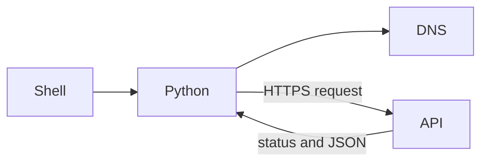

# From your shell to an HTTP request

Trace the path from your editor and shell to a service on another machine. These checks help you locate failures before you debug Python or the model.

**Supporting · 50 minutes** · **Prerequisites** [Build a Python CLI](python.md).

## The problem

Two people run the same code and see different results. One has a different Python interpreter. The other cannot reach the API hostname. Identify which boundary failed first.

## Isolate your environment

Create a virtual environment. It gives this project its own package installation directory.


```powershell
python -m venv .venv
.\.venv\Scripts\python.exe -c "import sys; print(sys.executable)"
.\.venv\Scripts\python.exe -m pip --version
```


On Bash, use `.venv/bin/python`. Expect both paths to point into `.venv`. Calling pip through Python reduces the chance of installing packages into a different interpreter. A dependency file makes the environment easier to recreate.

Use `git status --short` and `git diff` in a Git checkout before you commit. The first command shows affected paths. The second shows the tracked edits. Keep credentials in environment variables or a managed secret store. Commit the names of required settings so others can configure their own environment.

## Trace one request

A process is a running program. A server process listens on a port. DNS resolves a hostname to an address, TCP connects to a destination, TLS authenticates the HTTPS endpoint and encrypts the connection, and HTTP gives the request its method, path, headers, and body.





Use `curl.exe -I https://example.com/` on PowerShell or `curl -I https://example.com/` on Bash to inspect an HTTP HEAD response. A status line means the request reached an HTTP server or intermediary. A URL with an invalid hostname, such as `https://assistant.invalid/`, should fail to resolve on a direct connection. A proxy can produce its own error response in either case.

## Practice and debugging

If localhost refuses a connection, use `Get-NetTCPConnection -State Listen` on PowerShell or `ss -ltn` on Linux to check whether anything is listening. Use `Get-Process` or `ps` to identify the process. Check file permissions before diagnosing a permission error as a network issue. An HTTP `401` means a server or gateway responded and you can move on to credentials.

!!! tip "Start with the failing boundary"
    Record the command, interpreter, host, port, and error. Leave authorization headers and secret values out of your notes.

## Recap and next step

You can distinguish an environment, DNS, connection, TLS, or HTTP failure. [Next: Make a model call](first-model.md)

[Python virtual environments](https://docs.python.org/3.11/tutorial/venv.html), [HTTP semantics](https://www.rfc-editor.org/rfc/rfc9110.html), [Git status](https://git-scm.com/docs/git-status)
