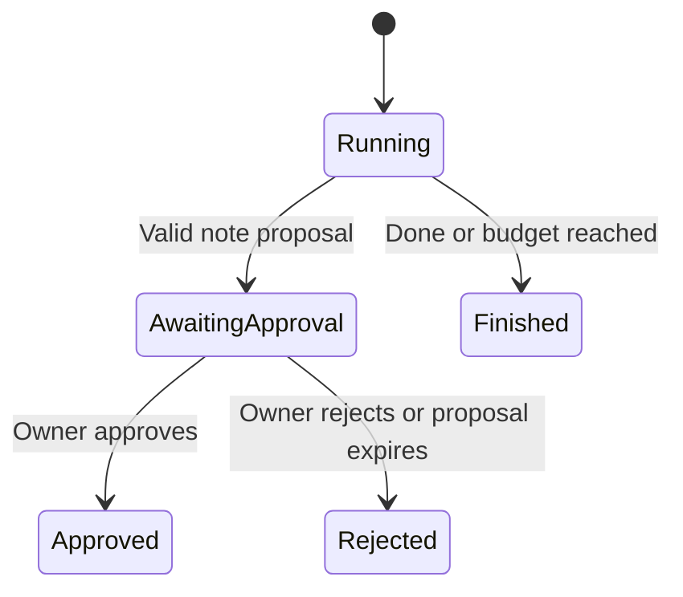

# Bound agent runs and approve writes

Run a small agent loop, pause before a write, and handle the same approval twice. The model proposes. Application code owns the decision and write.

**Core · 90 minutes** · **Prerequisites** [Build a deterministic tool workflow](workflows.md).

## The problem

A model can misunderstand the user's request or follow misleading text in a document. A note-saving action needs a clear permission boundary and a way for the user to confirm exactly what will be saved.

## Your first working example

This fixture stores one immutable proposal per run, compares the verified actor with the proposal owner, then records the first decision. The repeat returns the existing decision.


```python
--8<-- "examples/approvals.py"
```


Run `python -m examples.approvals`. Expect zero notes before approval, `approved`, and one note after repeating approval. In this in-memory example each dictionary disappears when the process exits.

## Add a bounded loop

Run `python -m examples.agent`. The scripted model first selects search, observes an authorized citation ID, then proposes a note. Expect `awaiting_approval` and `Saved notes: 0`. The loop can also finish, reject a bad tool or argument, or reach its three-step limit. [Review agent evaluation](orchestration.md) for the implementation.



## Extend and debug

Call `decide` as another owner and expect `PermissionError`. Confirm the note count stays zero. Start a fresh run, reject it, and then retry with approval. Expect the first decision, `rejected`, and zero notes.

## In production

Persist the run and proposed arguments. Bind approval to the authenticated actor, run and exact proposal. Show the action before the decision and expire old proposals. Use a transaction and unique action identifier to make the approval and write safe under retries and racing requests. Set tool, time and token budgets. Treat document text as untrusted and keep authorization in the tools and storage queries.

## Recap and next step

You separated model proposals, human decisions, and side effects. [Next: Evaluate and orchestrate agents](orchestration.md)

[LangGraph interrupts](https://docs.langchain.com/oss/python/langgraph/interrupts)
