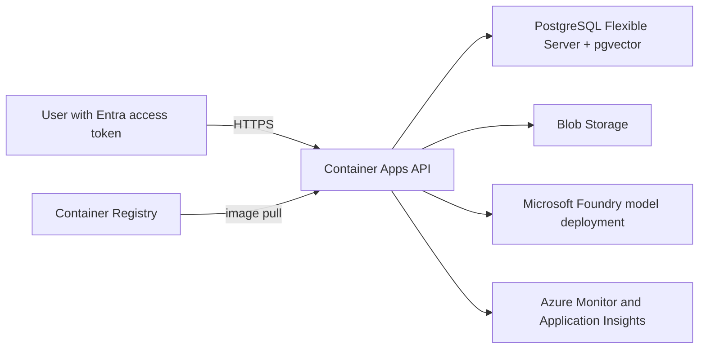

# Map the application to Azure

Choose Azure services for the running example and trace how the user and the workload each establish identity.

**Supporting · 70 minutes** · **Prerequisites** [Package the API with Docker](containers.md) and [Keep state and enforce ownership](../02-backend/state.md).

## The problem

A hosted Document Assistant needs a public request entry point, secure connections to its dependencies, and a way for operators to observe failures. The service choices should match the workload.

## Sketch the topology

This diagram is an architecture walkthrough. Exact subnet, access and region choices depend on the environment.

| Component | Responsibility |
| --- | --- |
| Container Apps | Runs the HTTP container and manages ingress and revisions |
| PostgreSQL Flexible Server | Holds conversations, permissions, jobs and vector data |
| Blob Storage | Holds uploaded bytes with anonymous access disabled |
| Microsoft Foundry | Hosts the selected chat and embedding deployments |
| Azure Monitor and Application Insights | Collects application and platform telemetry |

A subscription groups billing and access. A resource group groups resources for management and lifecycle. A region affects latency, data location, quota and service availability. Azure operates the managed platform. You still own data access, app settings, permission scopes and operational response.

## Trace one authenticated request

The API validates the end user's token and applies document access rules. The Container App can use managed identity to acquire a service token. Grant that identity the minimum data role at each service scope. For PostgreSQL with Entra authentication, map the identity to a database role and grant SQL permissions. For Blob, a container-scoped data role limits the workload's reach. Key Vault can hold a secret for an integration that still needs one.

Place PostgreSQL on private networking when the application can reach its private address. Check DNS and routes before debugging credentials. A `403` from Blob indicates that a request reached the service. Check the identity, data role, destination, and storage network rules.

## Compare the options

App Service can fit a conventional web app. Functions can fit event handlers with an appropriate execution and scaling model. Container Apps fits a web container and a separate worker without operating a Kubernetes cluster. AKS gives teams more orchestration control along with cluster responsibility. A virtual machine fits requirements for OS-level control and adds patching and host management.

??? info "Optional Kubernetes vocabulary"
    A pod is the smallest deployable workload unit. A Deployment rolls out replicas of pods and replaces them when needed. A Service gives clients a stable way to reach those replicas. A Horizontal Pod Autoscaler can adjust replica count using configured metrics. In AKS, platform setup and workload operations still need explicit owners. [Kubernetes objects](https://kubernetes.io/docs/concepts/overview/working-with-objects/)

## Practice and debugging

Assume the API identity receives a Blob data permission error after deployment. Show where you would check the account, container, token audience, role assignment scope, and which runtime identity requested the token. Confirm that a different identity without a data role gets denied. Treat role propagation and network restrictions as separate evidence to inspect.

A real deployment needs subscription access, resource and role assignment permissions, model capacity and quota, and a budget. Check current regional availability and treat logs, database capacity and inference as separate cost drivers.

## Recap and next step

You can explain the service boundaries, network path, and two kinds of identity. [Next: Describe infrastructure with Terraform](../07-devops/terraform.md)

[Container Apps managed identity](https://learn.microsoft.com/en-us/azure/container-apps/managed-identity), [PostgreSQL managed identity](https://learn.microsoft.com/en-us/azure/postgresql/security/security-connect-with-managed-identity), [Azure Well-Architected Framework](https://learn.microsoft.com/en-us/azure/well-architected/)
