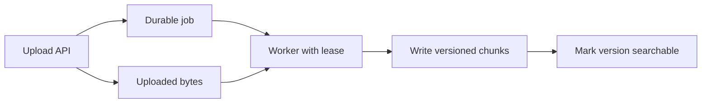

# Scale ingestion with queues and workers

Move slow parsing and embedding off the request path. Design a worker that can retry without publishing duplicate or incomplete chunks.

**Core · 85 minutes** · **Prerequisites** [Ingest documents and build chunks](../04-rag/ingestion.md) and [Keep state and enforce ownership](../02-backend/state.md).

## The problem

If an upload request waits for every page to parse and embed, it can time out halfway through. Retrying the request may start a second copy. Separate accepting the upload from processing it.

## Walk through an ingestion pipeline

Store the upload and mark its version pending. Enqueue an identifier for that version. A worker claims the job for a limited lease, fetches authorized data, parses, validates and embeds it, then publishes the revision. A status endpoint reports progress. Keep the queue message small and fetch document contents through an authorized service connection.

Use a key such as `(document_id, version, chunk_number)`. Write chunks and update publish status in a transaction. A retry can replace its own deterministic chunk IDs. Check that the worker still holds the current lease before committing so a late result cannot overwrite a newer attempt. Use exponential backoff with a retry limit and route persistent failures to a failed state or dead-letter queue.

## Choose a delivery model

A PostgreSQL job table is a practical starting point when job creation and metadata need one transaction. A worker can claim rows using `FOR UPDATE SKIP LOCKED` inside a short transaction and perform parsing after releasing the database lock. Azure Service Bus is an optional next step for durable message delivery and features such as dead-letter queues. If a database update and an external message must happen together, write a transactional outbox record and publish from it.

ETL transforms data before loading the target. ELT loads source data first and transforms where it lands. Our worker stages the raw file, then transforms it into indexed chunks. Batch ingestion processes groups of files. A streaming pipeline reacts to continually arriving events. Consider Kafka or Azure Event Hubs for replayable event streams with multiple consumers. Azure Data Factory can coordinate batch imports from existing systems when its connector and scheduling model fit. Microsoft also offers Data Factory in Microsoft Fabric for newer data integration workloads.

## Practice and debugging

A worker saves chunks and crashes before acknowledging a job. When the job is delivered again, inspect the job key, lease or delivery count, and active document version. Expect one published version when the retry completes. If the index contains duplicate chunks, check the uniqueness constraint and whether every attempt used the same version and chunk identifiers.

## In production

Watch the age of the oldest pending job, attempts per job, chunk count, pages rejected and time to searchable. Sample output for parse quality. Backpressure should limit new work when database or embedding capacity is exhausted. Schedule bulk reindexing separately from interactive answer traffic.

## Recap and next step

You can move ingestion to a durable worker and make duplicate delivery harmless. [Next: Track model and prompt changes](model-lifecycle.md)

[PostgreSQL locking clauses](https://www.postgresql.org/docs/current/sql-select.html#SQL-FOR-UPDATE-SHARE), [Azure Service Bus queues](https://learn.microsoft.com/en-us/azure/service-bus-messaging/service-bus-queues-topics-subscriptions), [Azure Event Hubs](https://learn.microsoft.com/en-us/azure/event-hubs/event-hubs-about), [Azure Data Factory](https://learn.microsoft.com/en-us/azure/data-factory/introduction)
