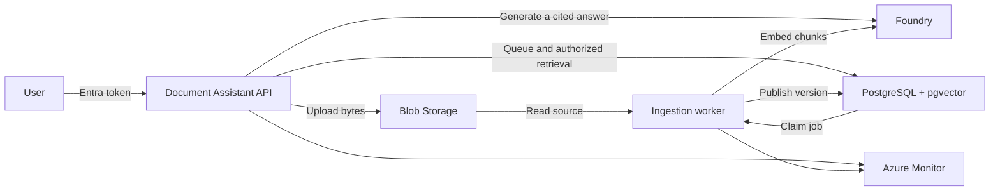

# Review the production design

Review a production design for Document Assistant. Use the earlier code and exercises as evidence, and turn failure cases into concrete release and incident decisions.

**Core · 120 minutes** · **Prerequisites** The RAG, approval, Azure, delivery, and production operations chapters.

## The problem

Two teams want to ask questions about policy documents. A released assistant must cite the policy version a user can access and pause before saving a note. The teams need a way to publish new policy versions and verify that users see the change.

## Draw the request and ingestion paths

Use Container Apps for the API and worker. Use Blob Storage for document bytes, PostgreSQL with pgvector for authorized search and job state, and Microsoft Foundry deployments for model requests. Use Entra user identity at the API boundary and workload identities for service connections. The diagram is a proposed topology. Region, network and permissions belong in an environment-specific design.





Describe how a validated request reaches retrieval, how citation lookup reuses the same access rules, and when a pending proposal becomes a saved note. Explain how the worker makes a new document version searchable without exposing a partially written index.

## Gather sample evidence

Run the following from the project root. Use the results alongside the earlier unauthorized-caller and invalid-input exercises.


```console
python -m examples.evaluation
python -m examples.agent
python -m examples.approvals
```


For the seeded training data expect recall@1 of `1.00`, a cited 30-day returns answer, abstention for the missing warranty policy, and zero notes before approval. Repeating approval should leave one note.

Define a stronger held-out benchmark for a release. Include exact terms, paraphrases, missing answers, outdated policies, and conflicts between teams. Example gates for a real design review are zero cross-team data leaks, zero unapproved writes, recall@5 of at least 90% across held-out answerable queries, and p95 response time under three seconds on a declared load profile. Confirm the thresholds with the users and adjust them if the actual workload requires it.

## Rehearse a release and incident

| Situation | Evidence to inspect | Recovery and check |
| --- | --- | --- |
| An upload never becomes searchable | Document status, oldest job, attempts, parse result | Requeue the same version after fixing the cause. Check that exactly one version is searchable. |
| Model latency rises and requests receive `429` | Provider quota, retries, model concurrency, trace timings | Reduce concurrency or shed load. Verify retries and p95 settle before restoring traffic. |
| A new revision cites an old policy | Revision, prompt, deployment and index versions | Restore traffic to the last compatible revision. Check the citation and verify the current schema still works with it. |

For a failed authorization case, pause the affected path, preserve diagnostic evidence, assess which users and records were affected, and rerun the isolation checks after a fix.

## Design review deliverables

Write a short architecture decision record and include your two request paths, identity and permission map, versioned release inputs, evaluation results, and incident checklist. Include estimated costs and a cleanup plan for any future Azure environment. Explain which workload metric would justify a new search service, broker or cache, and who would own it. Confirm a second reader can reproduce the sample checks and explain the first action for each incident.

## Recap and next step

You reviewed the full lifecycle of an AI application, from request validation and citations through Azure releases and incident response. [Back to the roadmap](../roadmap.md)

[Azure Well-Architected Framework](https://learn.microsoft.com/en-us/azure/well-architected/), [Azure Architecture Center](https://learn.microsoft.com/en-us/azure/architecture/)
